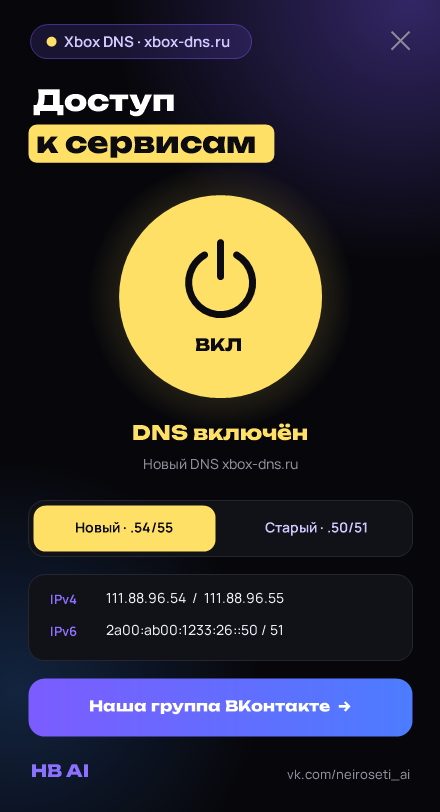

# HB AI · Smart DNS — ChatGPT, Claude, Gemini, ElevenLabs, Discord и YouTube одной кнопкой

Gemini, ElevenLabs или ChatGPT пишут «недоступно в вашей стране»? Эта бесплатная программа для Windows 10/11 (есть также [версия для Mac](#для-mac) и [версия для Linux](#для-linux)) одной кнопкой включает Smart DNS — [Comss.one](https://www.comss.ru/), [GeoHide](https://geohide.ru/) или [MagicDNS](https://magicdns.ru/), — и сервисы, которые сами ограничили работу в России, открываются как обычно. Остальной интернет при этом идёт напрямую: банки, Госуслуги и маркетплейсы работают как раньше.

> **Версия 1.23, 27 октября 2026.** В проверке сайтов появились Discord и YouTube: программа показывает, открываются ли они через выбранный сервис. Сами Smart DNS-сервисы Discord и YouTube не проксируют — DNS отдаёт их настоящие адреса, и сайты идут напрямую от провайдера, — но в проверке это теперь видно честно: если провайдер или что-то ещё мешает, вы увидите это сразу. На выбор «Найти лучший» они не влияют: сервис по-прежнему выбирается по нейросетям. Окно чуть выросло, карточка проверки теперь отображает 8 сайтов в двух аккуратных колонках. Добавлена версия и сборка для Linux (GUI + CLI, поддержка resolvectl, NetworkManager и автоматическое отключение IPv6).

> **Версия 1.22, 27 октября 2026.** Программа сама сообщает о новых версиях: при запуске она смотрит последний релиз на GitHub, и если он новее, вместо кнопки группы появляется жёлтая «Скачать версию …». Astracat убран: 27.10.2026 его DNS не отвечал. Если у вас остались адреса Astracat или российского узла GeoHide из прошлых версий, программа так и пишет и по нажатию кнопки ставит рабочие. Если у провайдера есть IPv6, программа на время Smart DNS выключает IPv6 на подключении (иначе Windows ходит к сайтам мимо Smart DNS) и включает его обратно при выключении; как сделать это вручную — [ниже](#ipv6). DNS и IPv6 программа теперь меняет напрямую через Windows (CIM), без запуска PowerShell. У Comss.one новый основной адрес `94.250.253.55` — как на его официальной странице. Исправлено: окно прыгало при нажатии на кнопку с движением мыши, «Найти лучший» переключал DNS, даже когда ни один сервис не работает, сбой при смене сервиса проходил молча, проверка иногда писала «DNS молчит» из-за одного потерянного пакета. Версия для Mac тоже обновлена до 1.22: те же сервисы, исправления, уведомление о новой версии и выключение IPv6.

> **Версия 1.21, 24 октября 2026.** Окно программы для Windows подстраивается под масштаб экрана: при 125–150 % и выше текст больше не наползает и не обрезается, а если окно не помещается по высоте (ноутбук с масштабом 150 %), оно уменьшается целиком. Смена масштаба и перенос окна на другой монитор тоже учитываются. Версия для Mac не менялась.
>
> **Версия 1.2, 23 октября 2026.** В программе появилась проверка: кнопка «Проверить» показывает, какие сайты открываются через выбранный сервис, а «Найти лучший» сама перебирает все сервисы и включает тот, где открывается больше всего. После включения DNS проверка запускается сама. Список сервисов обновлён по проверке из России 23.10.2026: добавлены MagicDNS и Astracat, российский узел GeoHide убран (его прокси из России не открываются), Comss.one остался, но Gemini через него упирается в капчу Google. Xbox DNS по-прежнему только для Xbox Live. Такие сервисы бесплатные, и доступ через них то пропадает, то возвращается: если сайт не открывается, нажмите «Найти лучший».

<p>
<a href="https://github.com/animesao/hb-ai-xbox-dns/releases/latest/download/HB_AI_Xbox_DNS.exe"></a>
<a href="https://github.com/animesao/hb-ai-xbox-dns/releases/latest/download/HB_AI_Smart_DNS_mac.zip"></a>
</p>

Нажмите на кнопку — файл скачается сразу. На Mac дальше смотрите [раздел «Для Mac»](#для-mac), на Windows:
1. Откройте скачанный `HB_AI_Xbox_DNS.exe`.
2. Если Windows напишет «Windows защитила ваш компьютер», нажмите **Подробнее** → **Выполнить в любом случае**, а на вопрос о правах администратора — **Да**.
3. Выберите сервис и нажмите большую кнопку в окне программы.

Не скачивается по кнопке? Прямые ссылки: [для Windows](https://github.com/animesao/hb-ai-xbox-dns/releases/latest/download/HB_AI_Xbox_DNS.exe) · 230 КБ · Windows 10/11, [для Mac](https://github.com/animesao/hb-ai-xbox-dns/releases/latest/download/HB_AI_Smart_DNS_mac.zip) · 870 КБ · macOS 13+, [для Linux](https://github.com/animesao/hb-ai-xbox-dns/releases/latest/download/HB_AI_Smart_DNS_linux.tar.gz) · Linux (любой дистрибутив). Бесплатно, открытый код.



Не нужно искать адреса DNS и вручную менять настройки сетевого адаптера.

Оригинальное приложение создано сообществом [«Нейросети и AI на практике»](https://vk.com/neiroseti_ai) (исходный репозиторий: [neiroseti-ai/hb-ai-xbox-dns](https://github.com/neiroseti-ai/hb-ai-xbox-dns)). В данном форке добавлена поддержка Linux (GUI + CLI), автоматическая кроссплатформенная сборка, а также проверка доступности Discord и YouTube.

## Что умеет

- Включает Smart DNS на всех активных сетевых подключениях, а выключает, возвращая обычный DNS от роутера или провайдера.
- Даёт выбрать сервис:

| Кнопка | Адреса | Что открывает (проверено 27.10.2026 из Москвы, МГТС) |
|---|---|---|
| Comss | `94.250.253.55`, `212.109.195.93` | ChatGPT, Claude, Gemini, ElevenLabs, Grok, Perplexity; Discord и YouTube — напрямую |
| GeoHide EU | `143.20.64.192`, `45.13.237.213` | ChatGPT, Claude, ElevenLabs, Grok, Perplexity; Gemini — капча Google; Discord и YouTube — напрямую |
| MagicDNS | `109.120.132.43`, `94.249.177.102` | ChatGPT, Claude, Gemini, ElevenLabs, Grok, Perplexity; Discord и YouTube — напрямую |
| Xbox | `111.88.96.54`, `111.88.96.55` | только Xbox Live, нейросети — нет |

- Кнопка **«Проверить»** спрашивает DNS выбранного сервиса напрямую, подключается к выданному адресу и показывает по каждому сайту: открывается, блок страны, капча Google или нет связи. Проверяются ChatGPT, Claude, Gemini, ElevenLabs, Grok, Perplexity, Discord и YouTube. Discord и YouTube сервисы не проксируют — они идут напрямую от провайдера, но в проверке это видно сразу. DNS для этого включать не обязательно.
- Кнопка **«Найти лучший»** делает то же для всех сервисов сразу и переключает программу на тот, где открывается больше всего нейросетей (Discord и YouTube на выбор не влияют: они от сервиса не зависят).

- При запуске показывает, что сейчас включено.
- После каждого переключения очищает кэш DNS.

## Как пользоваться

1. Скачайте `HB_AI_Xbox_DNS.exe` в разделе [Releases](../../releases).
2. Запустите и разрешите запуск от имени администратора: без этих прав Windows не даст поменять DNS.
3. Выберите сервис и нажмите на большую кнопку. Если нужный сайт не открылся, выберите другой сервис: программа сразу переключит DNS.

У файла нет цифровой подписи, поэтому Windows может показать «Неизвестный издатель». Сверить, что файл не подменили, можно по SHA-256: он указан в описании релиза.

Проверить сумму у себя:

```
certutil -hashfile HB_AI_Xbox_DNS.exe SHA256
```

## Для Mac

Есть версия для macOS 13 и новее с теми же сервисами, той же проверкой и тем же уведомлением о новой версии. Скачайте [HB_AI_Smart_DNS_mac.zip](https://github.com/animesao/hb-ai-xbox-dns/releases/latest/download/HB_AI_Smart_DNS_mac.zip), распакуйте и перетащите «HB AI Smart DNS» в «Программы».

1. При первом запуске macOS скажет, что разработчик не проверен: нажмите на программу правой кнопкой → **Открыть** → **Открыть**. Это нужно один раз. Если кнопки «Открыть» нет, снимите карантин в Терминале: `xattr -d com.apple.quarantine "/Applications/HB AI Smart DNS.app"`.
2. При включении DNS macOS попросит пароль администратора: DNS меняется стандартной командой `networksetup -setdnsservers`, а выключение возвращает автоматический DNS (`empty`). Если провайдер даёт IPv6, в той же команде IPv6 выключается (`networksetup -setv6off`) и при выключении возвращается в «Автоматически» (`-setv6automatic`); список таких подключений — в `~/Library/Application Support/HB AI Smart DNS/ipv6-off.txt`.
3. Кнопки «Проверить» и «Найти лучший» работают так же, как в Windows: через `dig` и `curl`, которые есть в каждой macOS.

Сборка: `bash mac/build.sh` на Mac или в GitHub Actions ([.github/workflows/mac.yml](.github/workflows/mac.yml)). Код: [mac/Sources/HBAISmartDNS](mac/Sources/HBAISmartDNS). Программа подписана ad hoc, без аккаунта разработчика Apple.

## Для Linux

Есть версия для Linux с графическим окном (Tkinter) и консольным режимом (CLI). Скачайте [HB_AI_Smart_DNS_linux.tar.gz](https://github.com/animesao/hb-ai-xbox-dns/releases/latest/download/HB_AI_Smart_DNS_linux.tar.gz), распакуйте и выполните установку:

```bash
tar -xzvf HB_AI_Smart_DNS_linux.tar.gz
cd HB_AI_Smart_DNS_linux
sudo ./install.sh
```

После установки программа доступна в меню приложений или из терминала:
- `hb-ai-smart-dns` — запуск графического окна
- `hb-ai-smart-dns --status` — текущее состояние DNS и IPv6
- `hb-ai-smart-dns --enable comss` — включить Smart DNS (Comss, GeoHide, MagicDNS или Xbox)
- `hb-ai-smart-dns --disable` — выключить Smart DNS (вернуть автоматический от роутера)
- `hb-ai-smart-dns --check` — проверить доступность сайтов
- `hb-ai-smart-dns --best` — найти и включить лучший сервис
- `hb-ai-smart-dns --cli` — интерактивное текстовое меню в консоли

Поддерживает `systemd-resolved` (`resolvectl`), `NetworkManager` (`nmcli`) и прямое управление `/etc/resolv.conf`. При включении Smart DNS на сетевых интерфейсах с глобальным IPv6 временно выключается IPv6 (`sysctl`), чтобы запросы не уходили к провайдеру, и восстанавливается при выключении.

Сборка: `bash linux/build.sh` или в GitHub Actions ([.github/workflows/linux.yml](.github/workflows/linux.yml)). Тесты: `python3 linux/tests.py`. Исходный код: [linux/](linux/).

## Как это работает

Программа меняет настройки Windows напрямую, через CIM — тот же механизм, на котором работают команды PowerShell. Сам PowerShell она не запускает. По действиям это то же самое, что:

```powershell
# включить
Set-DnsClientServerAddress -InterfaceIndex <подключение> -ServerAddresses ('94.250.253.55','212.109.195.93')
# только если у провайдера есть IPv6: выключить его на время Smart DNS (подключение запоминается)
Disable-NetAdapterBinding -Name <подключение> -ComponentID ms_tcpip6
# выключить
Set-DnsClientServerAddress -InterfaceIndex <подключение> -ResetServerAddresses
Enable-NetAdapterBinding -Name <подключение> -ComponentID ms_tcpip6   # только там, где программа выключала сама
Clear-DnsClientCache
```

Список подключений, где программа выключила IPv6, лежит в `C:\ProgramData\HB AI Smart DNS\ipv6-off.txt`. Если DNS сбросили не через программу, она вернёт IPv6 при следующем запуске.

Ещё при запуске программа один раз спрашивает GitHub, какой релиз последний (`/releases/latest`), чтобы сказать о новой версии. Больше она в сеть сама не ходит, кроме проверки сайтов по кнопкам «Проверить» и «Найти лучший».

Весь код лежит в одном файле: [XboxDns.cs](XboxDns.cs).

## IPv6

Smart DNS-сервисы (Comss.one, GeoHide, MagicDNS) работают только по IPv4. Если провайдер даёт IPv6, Windows может спрашивать IPv6-DNS провайдера и ходить к сайтам напрямую — тогда сайт пишет «недоступно в вашей стране», хотя DNS включён. Программа сама выключает IPv6 на время Smart DNS. Если хотите сделать это вручную:

1. Нажмите <kbd>Win</kbd>+<kbd>R</kbd>, введите `ncpa.cpl`, нажмите Enter — откроются сетевые подключения.
2. Правой кнопкой по подключению, через которое вы в интернете (Wi-Fi или Ethernet) → **Свойства**.
3. Снимите галочку **IP версии 6 (TCP/IPv6)** → **ОК**.

Чтобы включить обратно, поставьте галочку на месте. То же одной командой в PowerShell от имени администратора (вместо `Wi-Fi` — имя вашего подключения из `Get-NetAdapter`):

```powershell
Disable-NetAdapterBinding -Name 'Wi-Fi' -ComponentID ms_tcpip6   # выключить
Enable-NetAdapterBinding  -Name 'Wi-Fi' -ComponentID ms_tcpip6   # включить
```

Если удалили программу, пока DNS был включён, верните IPv6 так же: галочкой или командой `Enable-NetAdapterBinding`.

**На Mac:** Системные настройки → Сеть → ваше подключение (Wi-Fi или Ethernet) → **Подробнее** → **TCP/IP** → **Настроить IPv6**: «Выкл.» — выключить, «Автоматически» — вернуть. То же в Терминале:

```bash
networksetup -setv6off Wi-Fi         # выключить
networksetup -setv6automatic Wi-Fi   # вернуть
```

**На Linux:** В Терминале от имени root:

```bash
sudo sysctl -w net.ipv6.conf.all.disable_ipv6=1   # выключить
sudo sysctl -w net.ipv6.conf.all.disable_ipv6=0   # вернуть
```

## Частые вопросы

**Gemini пишет, что недоступен в вашей стране. Поможет?**
Да, это ровно тот случай. Comss.one и GeoHide отправляют адреса Gemini и Google AI Studio через свой сервер за границей, и сервис открывается.

**ElevenLabs перекидывает на страницу «not available in your country»**
Напрямую так и есть. С включённым DNS ElevenLabs открывается нормально, это мы тоже проверили.

**Работают ли ChatGPT и Claude?**
Да, через любой из четырёх сервисов для нейросетей. Если какой-то сайт не открывается, нажмите «Найти лучший»: программа проверит все сервисы и включит рабочий.

**Почему убрали российский узел GeoHide?**
23.10.2026 его DNS отвечал, но прокси-адреса, которые он выдаёт (193.233.112.x, 159.194.200.33), из России не открывались. Европейский узел GeoHide работает, он в программе остался.

**Это VPN?**
Нет. VPN гонит через чужой сервер весь трафик. Здесь меняется только DNS, и через сервер сервиса идут только запросы к нужным сайтам, а всё остальное работает напрямую, на полной скорости.

**Откроются ли Telegram, Instagram, Discord, YouTube и другие сайты, заблокированные в России?**
Нет. Сервисы по требованиям законов РФ работают по закрытому «белому списку» и ресурсы, заблокированные в России, не открывают. Discord и YouTube через них могут открываться — но потому, что DNS отдаёт их настоящие адреса и сайты идут напрямую от провайдера, а не потому, что сервис их разблокировал: если провайдер режет их сам, Smart DNS не поможет.

**Это не вирус? Почему просит права администратора?**
DNS в Windows меняется только с правами администратора, так же как если вписать адреса вручную в настройках сети. Программа не ставится в автозагрузку, сама никуда не подключается и данные не собирает. Весь код — один файл [XboxDns.cs](XboxDns.cs), его можно прочитать и собрать самому.

**Как вернуть всё как было?**
Нажмите кнопку ещё раз: программа вернёт автоматическое получение DNS от роутера или провайдера.

**Почему перестал работать Xbox DNS?**
С 10 октября 2026 года xbox-dns.ru на запросы к нейросетям отвечает `0.0.0.0`, так же отвечает и его зашифрованный DNS. Это решение сервиса, а не провайдера. Для Xbox Live он по-прежнему работает.

**Как включить Smart DNS вручную, без программы?**
Параметры → Сеть и Интернет → свойства подключения → Изменить назначение DNS-сервера → вписать, например, `94.250.253.55` и `212.109.195.93` (Comss.one). Программа делает то же самое одной кнопкой и сразу для всех подключений.

## Сборка из исходников

Отдельно ничего ставить не нужно: компилятор C# входит в .NET Framework 4, который есть в Windows 10 и 11. Запустите:

```
build.bat
```

Рядом появится `HB_AI_Xbox_DNS.exe`.

## Важно

- Программа не связана с Comss.one, GeoHide, MagicDNS и xbox-dns.ru. Это бесплатные сервисы: доступ через них может пропасть в любой момент. Адреса в программе мы проверяем скриптом `tools/probe_dns.py` и обновляем.
- Пользуйтесь сервисами по их правилам. Ресурсы, заблокированные в России, программа не открывает.
- Всё, что вы делаете с программой, вы делаете на свой риск.

## In English

**HB AI · Smart DNS** is a free, open-source one-click Smart DNS switcher for Windows 10/11. It sets Comss.one, GeoHide, MagicDNS or xbox-dns.ru DNS servers on all active network adapters (or resets them back to automatic), so services that restrict access from Russia — Gemini, ElevenLabs, ChatGPT, Claude — open normally, while all other traffic goes directly. No VPN, no background service, no installation: a single 230 KB exe that runs PowerShell commands (`Set-DnsClientServerAddress`, `Clear-DnsClientCache`, and `Disable/Enable-NetAdapterBinding` for IPv6 when the ISP provides it), checks GitHub for a newer release on start, and has a built-in reachability check for ChatGPT, Claude, Gemini, ElevenLabs, Grok, Perplexity, Discord and YouTube (the latter two are never proxied by these services — the check just shows whether they are reachable). Written in C#, MIT license. [Download the latest release](https://github.com/animesao/hb-ai-xbox-dns/releases/latest/download/HB_AI_Xbox_DNS.exe).

## Лицензия

Код распространяется по лицензии [MIT](LICENSE). Русский текст — [открытая лицензия по ст. 1286.1 ГК РФ](LICENSE.ru.md). Шрифты Unbounded и Manrope — по SIL Open Font License 1.1, тексты лицензий лежат в папке `res/`.
